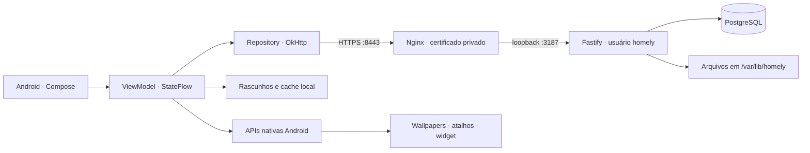

# Arquitetura do Homely

## Decisões

**Kotlin e Jetpack Compose no Android.** Integração direta com WallpaperManager, WallpaperService, ShortcutManager, AppWidgetManager, seletores do sistema e Android Keystore. Android mínimo 26, alvo/compilação 36. Dependências fixadas em um conjunto estável e compilado nesta entrega; atualizações devem passar pela mesma suíte.

**TypeScript/Fastify no servidor.** O app permanece inteiramente nativo. O backend usa o Node 22 e o PostgreSQL 16 já presentes na VPS, sem instalar outro runtime nem reiniciar os aplicativos existentes. Um serviço separado roda com usuário sem login, limite de memória e acesso de escrita restrito.

**PostgreSQL como fonte de verdade.** Perfis, sessões, temas, recursos, curtidas, coleções, seguidores e denúncias. Arquivos em disco, com UUID, hash SHA-256 e metadados no banco. A URL pública pode migrar depois para storage compatível com S3 sem mudar os tipos de recurso do manifesto.

## Organização Android

- `data/`: modelos serializáveis, HTTP, persistência da sessão e cache.
- `ui/`: sistema visual, telas e ViewModel com fluxo unidirecional.
- `platform/`: recursos do Android e leitura/escrita segura do pacote de temas.
- O módulo único reduz custo inicial. Essas fronteiras permitem extrair módulos de domínio/funcionalidades quando a equipe e o produto crescerem.

O feed cancela pesquisas anteriores, pagina o catálogo e guarda a última seleção principal para leitura offline. Coil mantém cache das imagens já vistas. Falhas de rede geram feedback, e publicação exige autenticação. Downloads usam o seletor de destino do Android, sem permissão ampla sobre arquivos do aparelho.

## Segurança implementada

Senhas derivadas com scrypt e salt aleatório, sessão opaca de 256 bits com hash no banco e validade de 30 dias; token cifrado com AES-GCM no Android Keystore. Nenhuma senha de VPS chega ao app.

SQL parametrizado, validação Zod, verificação de propriedade de todos os recursos publicados, arquivos nomeados pelo servidor, identificação de tipo por conteúdo, limites de tamanho e requisições. A rota de mídia aceita somente nomes UUID e extensões conhecidas. O importador de temas limita quantidade/tamanho, rejeita caminhos externos/duplicados e verifica hashes.

Uploads são recursos públicos por URL imprevisível, conforme aviso no app; não são um cofre privado. Fotos de perfil também são públicas. Exclusão da conta remove registros e arquivos próprios. Cópias previamente baixadas por terceiros não podem ser recolhidas.

## Produto e escalabilidade

Recomendações iniciais: mesma categoria primeiro, depois recência, sempre excluindo o tema atual. Métricas exibidas são reais; a coleção inicial começa com zero curtidas.

Próximos passos de infraestrutura conforme demanda: processamento assíncrono de miniaturas/vídeos, moderação de uploads, storage externo, cache/CDN, fila de tarefas, métricas e backups externos. A VPS atual é compartilhada e não foi submetida a teste de carga de produção.

## Referências oficiais

- [Compose BOM](https://developer.android.com/develop/ui/compose/bom)
- [WallpaperManager](https://developer.android.com/reference/android/app/WallpaperManager)
- [ShortcutManager](https://developer.android.com/reference/android/content/pm/ShortcutManager)
- [Segurança de rede Android](https://developer.android.com/privacy-and-security/security-config)
